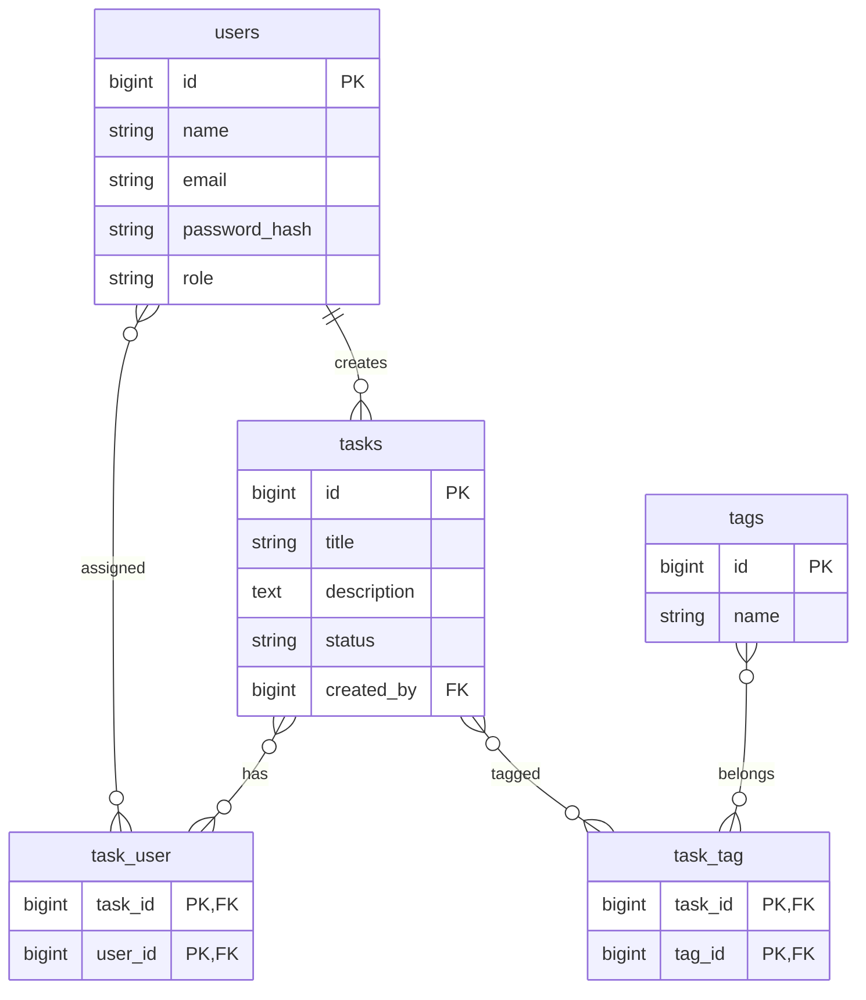

# Entity Relationship Diagram - TeamOrbit

## Tabel

### users
| Kolom | Tipe | Keterangan |
| --- | --- | --- |
| id | BIGINT UNSIGNED PK AUTO_INCREMENT | Identitas user |
| name | VARCHAR(255) | Nama user |
| email | VARCHAR(255) UNIQUE | Email login |
| password_hash | VARCHAR(255) | Hash password |
| role | ENUM('admin', 'member') DEFAULT 'member' | Role user |
| created_at | TIMESTAMP | Waktu dibuat |
| updated_at | TIMESTAMP | Waktu diperbarui |

### tasks
| Kolom | Tipe | Keterangan |
| --- | --- | --- |
| id | BIGINT UNSIGNED PK AUTO_INCREMENT | Identitas tugas |
| title | VARCHAR(100) NOT NULL | Judul tugas |
| description | TEXT NULL | Deskripsi tugas |
| status | ENUM('belum_selesai', 'selesai') DEFAULT 'belum_selesai' | Status tugas |
| created_by | BIGINT UNSIGNED FK users.id | User pembuat tugas |
| created_at | TIMESTAMP | Waktu dibuat |
| updated_at | TIMESTAMP | Waktu diperbarui |

### task_user (pivot)
| Kolom | Tipe | Keterangan |
| --- | --- | --- |
| task_id | BIGINT UNSIGNED FK tasks.id ON DELETE CASCADE | Tugas |
| user_id | BIGINT UNSIGNED FK users.id ON DELETE CASCADE | User assignee |
| PK | (task_id, user_id) | Primary key komposit |

### tags (opsional)
| Kolom | Tipe | Keterangan |
| --- | --- | --- |
| id | BIGINT UNSIGNED PK AUTO_INCREMENT | Identitas tag |
| name | VARCHAR(50) UNIQUE | Nama tag |
| created_at | TIMESTAMP | Waktu dibuat |
| updated_at | TIMESTAMP | Waktu diperbarui |

### task_tag (opsional)
| Kolom | Tipe | Keterangan |
| --- | --- | --- |
| task_id | BIGINT UNSIGNED FK tasks.id ON DELETE CASCADE | Tugas |
| tag_id | BIGINT UNSIGNED FK tags.id ON DELETE CASCADE | Tag |
| PK | (task_id, tag_id) | Primary key komposit |

## Relasi

- `users` 1:N `tasks` melalui `created_by`
- `tasks` N:M `users` melalui `task_user`
- `tasks` N:M `tags` melalui `task_tag`

## Diagram (Mermaid)

